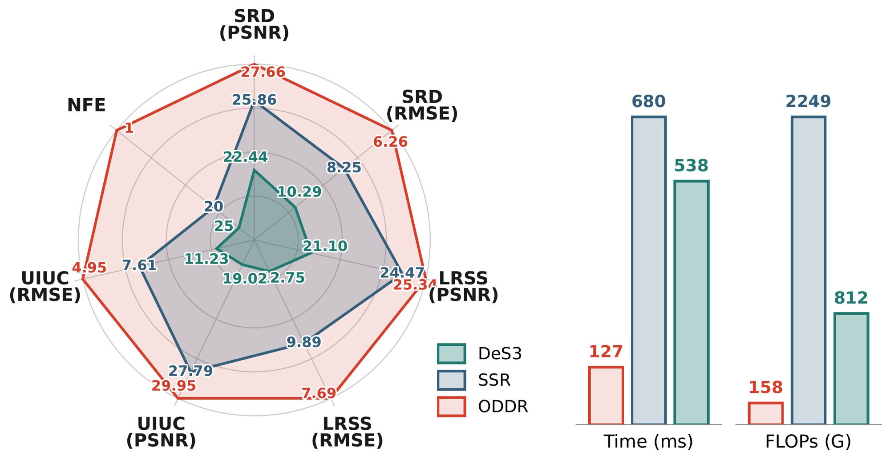
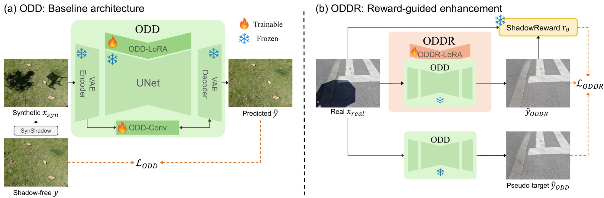
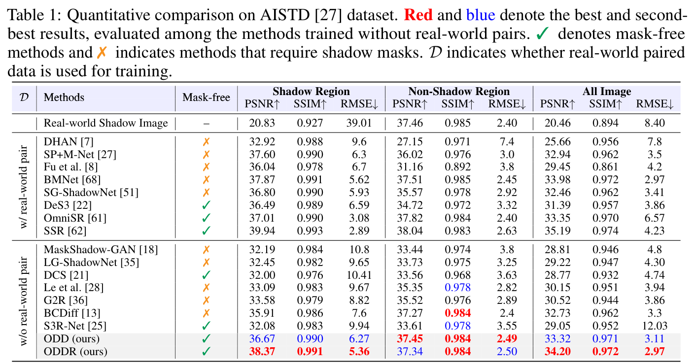
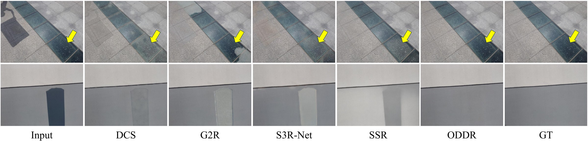
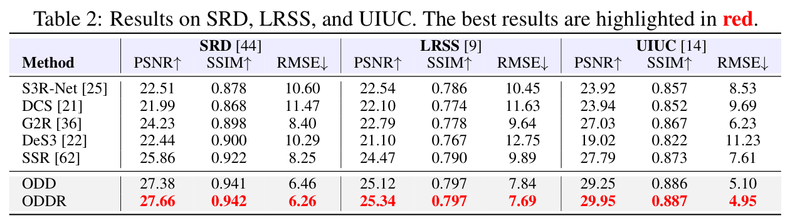
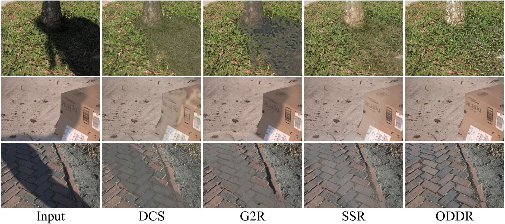
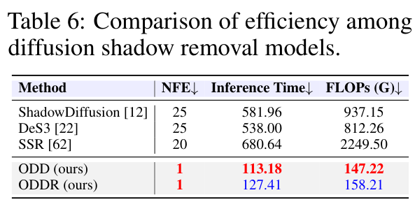

<div align="center">

# ODDR: One-Step Deshadow Diffusion via Reward Guidance

[Junseong Shin](https://junsung6140.github.io/)<sup>1</sup> · Kijun Kim<sup>2</sup> · Minseong Kim<sup>2</sup> · Dongjin Kim<sup>3</sup> · Tae Hyun Kim<sup>1,3†</sup>

<sup>1</sup>Department of Artificial Intelligence, Hanyang University · <sup>2</sup>AX Future Technology Institute, KT · <sup>3</sup>Department of Computer Science, Hanyang University

**NeurIPS 2026**

[](https://junsung6140.github.io/oddr_project_page/)
[](https://arxiv.org/abs/2610.01291)
[](LICENSE)

</div>

<p align="center"></p>

ODDR removes shadows in a single diffusion step without real-world paired training data and without a shadow mask at test time. It generalizes better than multi-step diffusion models (DeS3, SSR) on the unseen SRD, LRSS, and UIUC datasets while being much faster.

## News

- **2026-10**: Code, pretrained weights, and our result images are released.
- **2026-09**: ODDR is accepted to NeurIPS 2026.

## Abstract

Recent advances in deep learning for shadow removal have significantly enhanced image quality and realism. However, most approaches rely on real-world paired datasets, which are costly to collect and often limited in scene diversity, leading to limited generalization. To address these limitations, we propose One-step Deshadow Diffusion via Reward guidance (ODDR), a new framework that achieves efficient and high-fidelity shadow removal without relying on real-world paired supervision. Our method begins with One-step Deshadow Diffusion (ODD), a baseline model trained on synthetic shadow data for efficient one-step shadow-free reconstruction. We further adapt ODD into ODDR using ShadowReward. In contrast to traditional, annotation-heavy approaches, ShadowReward is the first reward model for shadow removal trained entirely without human annotation. It learns to mimic human perceptual judgments by ranking synthetically generated images with controlled degradations, such as texture distortion and boundary artifacts. This reward-guided fine-tuning enables ODDR to narrow the synthetic-to-real domain gap. Extensive experiments show that ODD achieves strong performance without relying on real-world paired supervision, and ODDR further improves the results, narrowing the gap to fully supervised methods trained on real-world paired data while maintaining higher computational efficiency as a single-step model.

## Method



Training has two stages on top of Stable Diffusion 2.1-base, used as a one-step network at t = 999.

1. **ODD.** We synthesize shadow images from shadow-free AISTD images with SynShadow shadow mattes and train ODD to recover the shadow-free image with an L1 and an LPIPS loss. Only the UNet LoRA (ODD-LoRA) and light convolutional skip connections between the VAE encoder and decoder (ODD-Conv) are trained.
2. **ODDR.** We freeze ODD, add a second LoRA (ODDR-LoRA), and fine-tune it on real AISTD shadow images without ground truth. The loss keeps the output close to the ODD output (L2 and LPIPS) and maximizes the ShadowReward score.

**ShadowReward** is trained without human labels. From a shadow-free image and a shadow matte, we build a ranked list: the clean image first, then copies with easy, medium, and hard degradations in the shadow region (boundary artifacts, color and luminance shifts, texture loss, noise, warping). A frozen DINOv2 encodes the shadow input and each candidate, a small convolutional head scores every patch, and the top-K patch scores give the reward. The head is trained with the ListMLE ranking loss.

## Results

### AISTD

<p align="center"></p>



### Unseen datasets: SRD, LRSS, and UIUC

<p align="center"></p>



### Efficiency

<p align="center"></p>

Our result images on AISTD, SRD, LRSS and UIUC can be downloaded [here](https://drive.google.com/file/d/1Wb9m_1Wq58021c4wYfg0pvwjfpdPzkBx/view?usp=sharing) (`ODDR_results.zip`, 655 MB).

## Getting started

### Installation

```bash
git clone https://github.com/junsung6140/ODDR.git
cd ODDR
conda create -n oddr python=3.10 -y
conda activate oddr
pip install -r requirements.txt
```

The code was tested with Python 3.10, PyTorch 2.0.1, and CUDA 11.7.

### Pretrained models

ODDR is built on **Stable Diffusion 2.1-base**. The original `stabilityai/stable-diffusion-2-1-base` repository is no longer available on Hugging Face. We use the community copy `sd2-community/stable-diffusion-2-1-base`, whose UNet and VAE weights are identical to the original (same SHA-256). Download it to `checkpoints/`:

```bash
huggingface-cli download sd2-community/stable-diffusion-2-1-base \
    --local-dir checkpoints/stable-diffusion-2-1-base
```

Our weights are in one zip file:

| File | Description | Download |
|---|---|---|
| `ODD.pkl` | Stage 1 model (ODD-LoRA + ODD-Conv) | |
| `ODDR.pkl` | Final model (ODD + ODDR-LoRA) | [ODDR_checkpoints.zip](https://drive.google.com/file/d/1DMsJM16l7-wF2VoytP6zKXtznMRI9P8E/view?usp=sharing) (272 MB) |
| `ShadowReward.pth` | ShadowReward head (the DINOv2 encoder is downloaded by `torch.hub`) | |

Unzip it into `checkpoints/`:

```bash
gdown 1DMsJM16l7-wF2VoytP6zKXtznMRI9P8E
unzip ODDR_checkpoints.zip
mkdir -p checkpoints && mv ODDR_checkpoints/* checkpoints/ && rmdir ODDR_checkpoints
```

The folder should look like this. These are the default paths in all scripts.

```
checkpoints/
├── stable-diffusion-2-1-base/
├── ODD.pkl
├── ODDR.pkl
└── ShadowReward.pth
```

ShadowReward loads DINOv2 ViT-B/14 with `torch.hub.load('facebookresearch/dinov2', 'dinov2_vitb14')`, so the first run needs internet access.

### Inference

ODDR is mask-free: it only needs the shadow image. Inputs of any size are reflect-padded to a multiple of 64 and cropped back after decoding.

```bash
# a single image
python inference.py -i path/to/shadow.png -o outputs

# a folder of images
python inference.py -i path/to/folder -o outputs

# the stage 1 model
python inference.py -i path/to/folder -o outputs_odd --ckpt_path checkpoints/ODD.pkl
```

Inference uses fp16 by default (`--mixed_precision fp32` for full precision). The VAE encoder samples its latent, so we fix the seed (`--seed 42`) for repeatable outputs.

### Data preparation

Put the datasets under `data/` as follows (or pass other paths to the scripts):

```
data/
├── AISTD/                         # ISTD with the adjusted ground truth (ISTD+)
│   ├── train/
│   │   ├── train_A/               # shadow images (ODDR fine-tuning)
│   │   └── train_C_fixed_ours/    # adjusted shadow-free images (ODD and ShadowReward)
│   └── test/
│       ├── test_A/                # shadow images
│       ├── test_B/                # shadow masks (evaluation only)
│       └── test_C_fixed_official/ # adjusted shadow-free images
├── SynShadow/
│   └── matte/                     # SynShadow shadow mattes (*.png)
├── SRD/test/{shadow, shadow_free}/
├── LRSS/{testA, testB}/           # shadow / shadow-free
└── UIUC/{test_A, test_C}/         # shadow / shadow-free
```

- **AISTD**: download ISTD from [ISTD](https://github.com/DeepInsight-PCALab/ST-CGAN) (train_A, train_B, test_A, test_B) and the adjusted shadow-free images (train_C_fixed_ours, test_C_fixed_official) from [ISTD+ / SID](https://github.com/cvlab-stonybrook/SID).
- **Synthetic training data**: download the SynShadow dataset from [SynShadow](https://github.com/naoto0804/SynShadow/tree/master/datasets) and put its shadow mattes in `data/SynShadow/matte/`. No synthetic images need to be prepared in advance. ODD pairs and the ranked lists of ShadowReward are generated on the fly from the AISTD shadow-free images and randomly sampled mattes, with the SynShadow affine shadow model (`dataloaders/synshadow.py`).
- **SRD, LRSS, UIUC**: test sets only, used for the cross-dataset evaluation in Table 2. For UIUC we use the 44 test pairs with consistent lighting.

### Evaluation

Run ODDR on the four test sets:

```bash
bash scripts/test.sh                                  # ODDR, results in results/
bash scripts/test.sh checkpoints/ODD.pkl results_odd  # ODD
```

All metrics are computed at 256x256. "RMSE" is the mean absolute error in LAB color space, as in prior shadow removal work. The numbers in Table 1 and Table 2 follow the standard MATLAB evaluation used in prior shadow removal work (`evaluation/measure_shadow.m`, from ShadowFormer; PSNR and SSIM lines, and the PP-Lab line for RMSE):

```matlab
measure_shadow('results/AISTD/', 'data/AISTD/test/test_C_fixed_official/', 'data/AISTD/test/test_B/')
```

Table 2 reports whole-image metrics. We also provide a Python port for quick checks without MATLAB. Its numbers are lower than the MATLAB ones (on AISTD with our ODDR results: 38.11 / 36.60 / 33.68 PSNR for shadow / non-shadow / all, against 38.37 / 37.34 / 34.20 in Table 1), mainly from differences in resizing and color conversion. Please use the MATLAB script when you compare with the numbers in the paper.

```bash
bash scripts/eval.sh results
# or for one dataset
python evaluation/eval_shadow.py --result_dir results/AISTD \
    --gt_dir data/AISTD/test/test_C_fixed_official --mask_dir data/AISTD/test/test_B
```

To score results with ShadowReward:

```bash
python score_reward.py --input_dir data/AISTD/test/test_A --result_dir results/AISTD
```

### Training

The released models were each trained on a single GPU with 48 GB of memory. Run `accelerate config` once to set up `accelerate`.

**1. ODD** (`scripts/train_odd.sh`): 40K steps, batch size 4, 512x512 crops, AdamW with learning rate 2e-4 (500 warmup steps, cosine decay to 1e-6), fp16. Losses: L1 + 2 x LPIPS (VGG). LoRA rank 16. The released `ODD.pkl` is the checkpoint at 30K steps.

```bash
bash scripts/train_odd.sh
```

**2. ShadowReward** (`scripts/train_reward.sh`): 20K steps, batch size 16, random 512x512 crops resized to 448x448, AdamW with learning rate 1e-4 (1K warmup steps, cosine decay), ListMLE with temperature 1, top-K ratio 0.1, list length 3 (GT, easy, medium, hard). The released `ShadowReward.pth` is the final checkpoint. It does not depend on ODD, so it can be trained before or in parallel with stage 1.

```bash
bash scripts/train_reward.sh
```

**3. ODDR** (`scripts/train_oddr.sh`): starts from `checkpoints/ODD.pkl` and uses `checkpoints/ShadowReward.pth`. 20K steps, batch size 4, 512x512 crops of real AISTD shadow images, AdamW with a constant learning rate of 1e-6, fp16. Losses: L2 and 2 x LPIPS to the frozen ODD output, minus 0.1 x ShadowReward. Only ODDR-LoRA (rank 16, zero-initialized output) is trained. The released `ODDR.pkl` is the checkpoint at 16.5K steps.

```bash
bash scripts/train_oddr.sh
```

Checkpoints are saved to `experiments/<run>/checkpoints/model_<step>.pkl` (or `.pth` for ShadowReward) and can be used directly with `inference.py --ckpt_path`.

## Citation

```bibtex
@inproceedings{shin2026oddr,
  title     = {ODDR: One-Step Deshadow Diffusion via Reward Guidance},
  author    = {Shin, Junseong and Kim, Kijun and Kim, Minseong and Kim, Dongjin and Kim, Tae Hyun},
  booktitle = {Advances in Neural Information Processing Systems (NeurIPS)},
  year      = {2026}
}
```

## License

The code and the ODDR weights are released under the [CC BY-NC 4.0](https://creativecommons.org/licenses/by-nc/4.0/) license (see [LICENSE](LICENSE)). Files derived from OSEDiff and diffusers keep their Apache License 2.0 (see [LICENSE-OSEDiff](LICENSE-OSEDiff)). The models are built on Stable Diffusion 2.1-base (CreativeML Open RAIL++-M) and DINOv2 (Apache License 2.0). Please also follow their terms when you use the weights.

## Acknowledgements

This code is built on [OSEDiff](https://github.com/cswry/OSEDiff). We thank the authors for releasing their code.

```bibtex
@inproceedings{wu2024one,
  title     = {One-Step Effective Diffusion Network for Real-World Image Super-Resolution},
  author    = {Wu, Rongyuan and Sun, Lingchen and Ma, Zhiyuan and Zhang, Lei},
  booktitle = {Advances in Neural Information Processing Systems (NeurIPS)},
  year      = {2024}
}
```

We also thank the authors of [diffusers](https://github.com/huggingface/diffusers), [AdcSR](https://github.com/Guaishou74851/AdcSR) (time- and text-free UNet forward), [SynShadow](https://github.com/naoto0804/SynShadow) (shadow mattes and the shadow synthesis model), [DINOv2](https://github.com/facebookresearch/dinov2), [LPIPS](https://github.com/richzhang/PerceptualSimilarity), and [ShadowFormer](https://github.com/GuoLanqing/ShadowFormer) (evaluation script).
